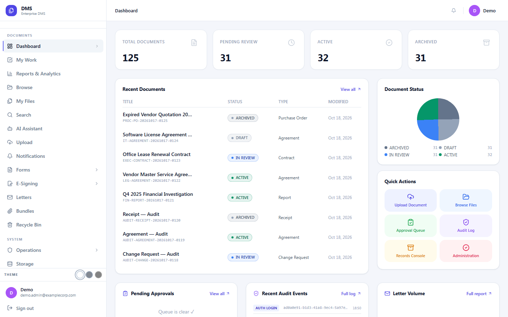
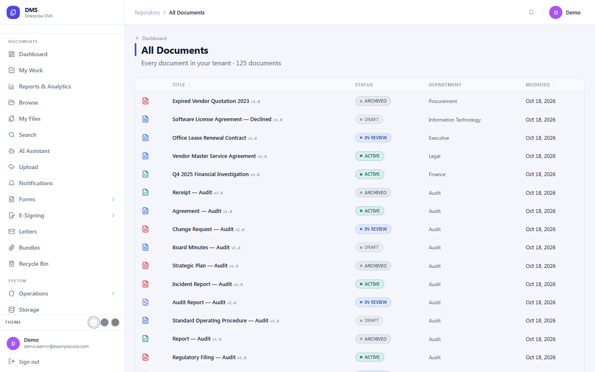
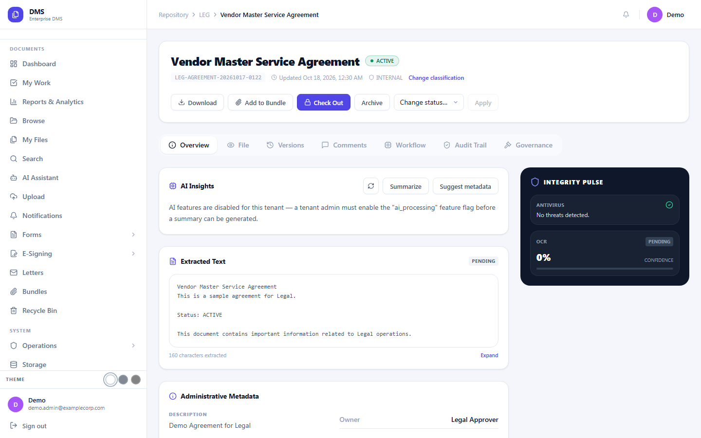
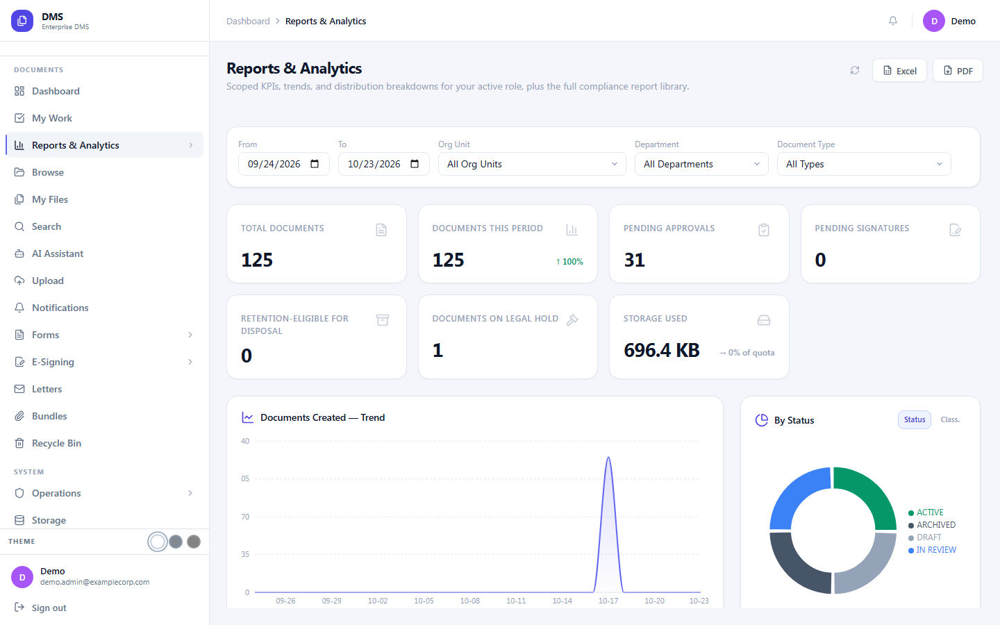
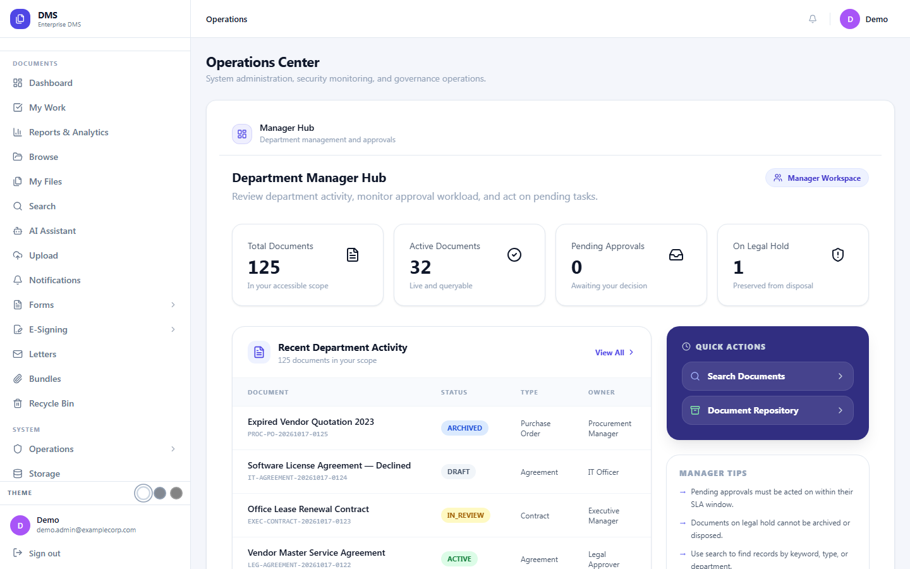
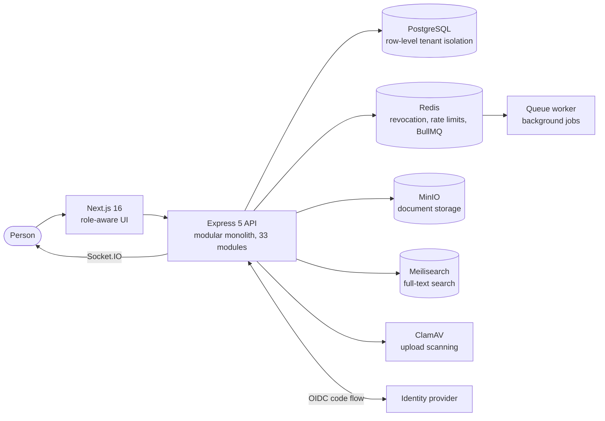

# Document and Records Platform (DMS)

A multi-tenant platform for the whole life of an organisation's documents: capture, classification, versioning, approval, e-signing, archive, retention, legal hold and certified disposal, plus a correspondence module for incoming and outgoing letters.

> **This is the public showcase.** It holds the write-up, screenshots and a live demo. The source code is private; see [Source access](#source-access).

| | |
|---|---|
| **What it is** | Document, records and correspondence management as a modular monolith |
| **Stack** | TypeScript, Express 5, Next.js 16 (React 19), PostgreSQL, Redis and BullMQ, Socket.IO, MinIO, Meilisearch |
| **Quality** | 1,639 automated tests in 116 suites (test report generated and checked in CI), Playwright end-to-end specs, live verifiers that run against a real database |
| **Live demo** | [Open it from the portfolio](https://dawitbkportfolio.vercel.app/#demos), which shows whether the demo server is online and has the sandbox login |
| **My role** | Architect and lead engineer: requirements, design, build, deployment and verification |

## Try it live

1. Open the **demo access** card on the [portfolio](https://dawitbkportfolio.vercel.app/#demos) for the shared sandbox administrator login.
2. Sign in at the [identity portal](https://saas-portal-iota.vercel.app/sso/portal) and open **Document Management**. You are signed in through single sign-on.
3. Try a document: open its tabs for versions, workflow, audit trail and governance.

The demo runs on a server of my own, so it is sometimes offline (a restart, a power cut or maintenance). The portfolio shows its status and, when it is offline, how to reach me. The data is synthetic. The AI features are switched off for the demo tenant on purpose, because sending text to a model provider is a per-tenant decision.

## Screenshots

| | |
|---|---|
|  |  |
| **Dashboard.** Counts, recent documents, status mix, quick actions, pending approvals and recent audit events. | **Documents.** Every document in the tenant with status, department and sortable columns. |
|  |  |
| **A document.** Classification, check-out, status change, and tabs for versions, workflow, audit and governance. An integrity panel shows antivirus and OCR state. | **Reports.** Scoped KPIs, trends and distributions, with Excel and PDF export. |
|  | |
| **Operations center.** Role-aware hubs for managers, records and administrators. | |

## What it does

- **Lifecycle.** A 17-state document lifecycle, versioning with check-out, check-in, rollback and a word-level version diff, folders and bundles, a recycle bin, bulk operations and resumable uploads.
- **Approvals.** One approval engine shared by documents, form templates and form instances, with SLAs and escalation.
- **E-signing.** Electronic and PKI signing, PAdES-signed flattened PDF copies, and a public signing page for external signers.
- **Search and OCR.** Full-text search through Meilisearch with a PostgreSQL fallback, and an OCR pipeline (Tesseract, with text extraction for digital PDFs and rasterisation for scans).
- **Records management.** Retention policies with certified disposal, legal hold, and warm, cold and WORM archive tiers.
- **Correspondence.** Outgoing letters with a maker, checker and approver chain; gap-free reference numbers allocated only at final approval; letterhead PDFs with a QR code; public QR verification with no login; incoming registration, cross-reference threading, dispatch and delivery tracking.
- **Forms.** A form builder with approval of templates and document-backed submissions.
- **Opt-in AI assistant.** Vendor-neutral. Staff ask questions over documents and audit logs through tenant-scoped tool calls, and get document summaries and metadata suggestions. Each tenant must consent, and usage is governed by policy and quotas.
- **Integration.** Real-time notifications over Socket.IO, HMAC-signed outbound webhooks, Prometheus metrics, TOTP two-factor sign-in, ClamAV scanning of uploads.
- **Compliance.** An immutable, hash-chained audit log and compliance reports.

## Architecture

### Design decisions

- **Two layers of authorisation.** Every endpoint declares a permission (53 of them, resolved from role grants stored in the database). A resource ACL is then evaluated for the specific document or folder, deny-first, walking folder and department ancestry. A deny at any level wins. The UI never matches on role names; it asks whether the person can do the thing.
- **Tenant isolation in the database.** Row-level security backs the application checks, and a user from another tenant reads as "not found" for everybody.
- **Fail closed.** If Redis is down, the system refuses a token whose logout or revocation it cannot verify, instead of honouring it.
- **A modular monolith.** Clear module boundaries and transactional outbox patterns, without the operating cost of many services.
- **Roles from the identity provider.** Sign-in is a standard OIDC code flow. Roles arrive as claims, are mapped per relying party, and users are provisioned just in time. Only an unmatched user falls back to the lowest role.
- **Reference numbers that cannot have gaps.** They are allocated at final approval, not at draft time, so a withdrawn draft never burns a number.
- **Degrades honestly.** Search falls back to PostgreSQL and storage to local disk when the services are down, and the documentation says why that convenience is also a trap.

## Quality and operations

- 1,639 automated tests (Jest and Vitest), Playwright end-to-end specs, and live verifiers that run against a running backend and a real database to prove behaviour unit tests cannot reach.
- Forward SQL migrations, each with a down script, and a documented expand and contract approach for shipping changes once real users depend on the system.
- A written requirements set, a permission and scope matrix, a disaster recovery runbook, deployment runbooks, a TLS hardening guide, and a manual end-to-end retest checklist of 252 cases across 26 sheets.
- Releases are signed, preflight-checked and backed up first, with rollback.

## Source access

The code is private. If you are hiring, collaborating or reviewing, I am happy to walk through it on a call or give read-only access to the repository. Email [dawitbk01@gmail.com](mailto:dawitbk01@gmail.com) or open an issue titled "Source access request".

## Related showcases

- [Identity platform (SSO)](https://github.com/DawitBK/sso-showcase)
- [Guest platform (GMS)](https://github.com/DawitBK/gms-showcase)
- [Portfolio](https://dawitbkportfolio.vercel.app) and [resume](https://dawitbkportfolio.vercel.app/Dawit-Bayou-Kassie-Resume.pdf)

## About this repository

The text and screenshots are from the live sandbox, taken on 23 October 2026. Organisations and people shown are fictional ("Example Corp"). See [LICENSE](LICENSE): the text and images may be viewed and linked to; the software they describe is not part of this repository and is not licensed by it.
